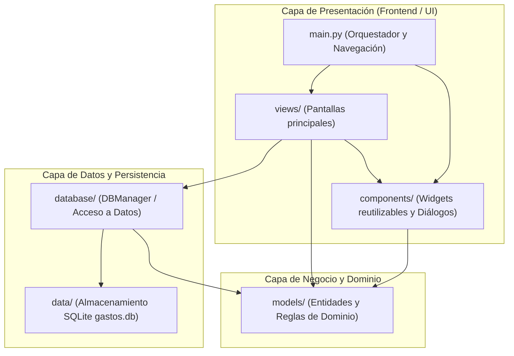
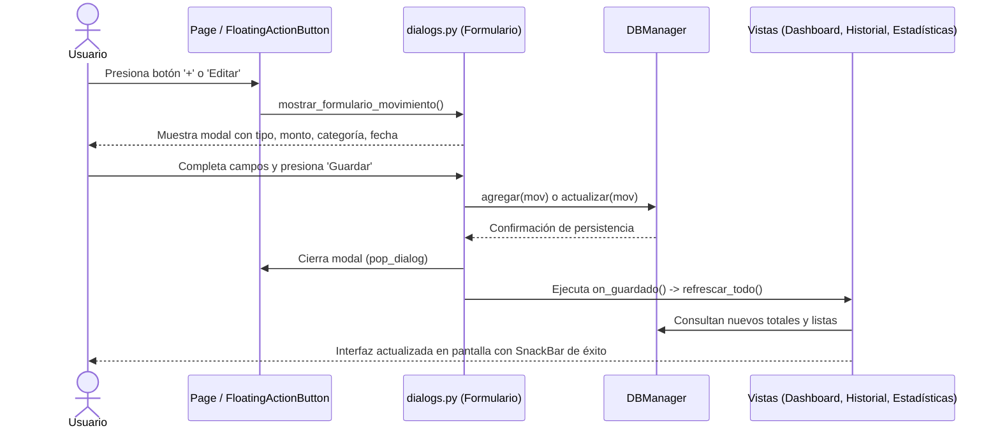

# Arquitectura, Estructura y Funcionamiento del Proyecto

Este documento detalla la estructura del proyecto **Control de Gastos** desarrollado con **Python** y **Flet** (con persistencia en **SQLite**), explicando el propósito de cada directorio, sus archivos, la arquitectura de diseño empleada y el ciclo de vida del flujo de datos.

---

## 1. Visión General de la Arquitectura

La aplicación implementa una **arquitectura modular en capas (separación de responsabilidades)** inspirada en el patrón **MVC (Modelo - Vista - Controlador / Componente)**:



### Principios de diseño aplicados

1. **Desacoplamiento**: Las vistas no realizan sentencias SQL directas; delegan la persistencia a la capa `database/`.
2. **Reutilización de componentes**: Tarjetas, listas y modales se aíslan en `components/` para evitar duplicar código.
3. **Tipado y modelos sólidos**: Los registros de la base de datos se transforman a objetos de dominio fuertemente tipados definidos en `models/`.
4. **Reactividad de estado**: Las acciones del usuario (crear, editar, eliminar) disparan eventos de refresco sincronizados (`refrescar_todo`) en todas las vistas activas.

---

## 2. Explicación Detallada de Carpetas y Contenido

```
Proyecto APP/
├── data/                  # Almacén de persistencia física (SQLite)
├── database/              # Capa de acceso a datos (Queries, CRUD, Conexión)
├── models/                # Entidades de dominio, constantes e íconos
├── components/            # Widgets gráficos y ventanas modulares
├── views/                 # Pantallas completas (Dashboard, Historial, Estadísticas)
└── main.py                # Punto de entrada y orquestador global
```

---

### 📂 `data/` (Persistencia Física)

- **Propósito**: Alojar los archivos físicos generados durante el almacenamiento de la información.
- **Contenido**:
  - `gastos.db`: Base de datos relacional local basada en **SQLite**.
- **Funcionamiento**: Si este archivo no existe al iniciar la aplicación, la clase `DBManager` crea la carpeta `data/` y el archivo `gastos.db` de forma automática, insertando registros de ejemplo para que la aplicación sea interactiva desde el primer inicio.

---

### 📂 `database/` (Capa de Acceso a Datos / Data Access Layer)

- **Propósito**: Aislar toda la lógica relacionada con sentencias SQL, aperturas de conexión, transacciones y transformaciones hacia la base de datos.
- **Archivos**:
  - `__init__.py`: Marca la carpeta como paquete de Python.
  - `db_manager.py` (Clase `DBManager`):
    - **Manejo de conexión**: Configura `sqlite3.connect(..., check_same_thread=False)` para permitir operaciones seguras en el modelo multihilo de Flet.
    - **Inicialización (`init_db`)**: Crea la tabla `movimientos` con campos: `id`, `tipo`, `categoria`, `descripcion`, `monto` y `fecha`.
    - **Operaciones CRUD**:
      - `agregar(mov)`: Inserta un registro y asigna el nuevo ID al objeto.
      - `obtener_todos(busqueda, tipo, categoria, limite)`: Consulta flexible con filtros dinámicos y orden cronológico descendente.
      - `obtener_por_id(mov_id)`: Recupera un movimiento específico.
      - `actualizar(mov)`: Modifica los datos de un movimiento existente.
      - `eliminar(mov_id)`: Elimina un registro por ID.
    - **Métricas y Agregaciones**:
      - `obtener_resumen()`: Calcula la sumatoria de ingresos, gastos y balance neto.
      - `obtener_gastos_por_categoria()`: Realiza agregaciones (`GROUP BY categoria`, sumas y porcentajes relativos de gastos).

---

### 📂 `models/` (Dominio y Estructuras de Datos)

- **Propósito**: Definir las estructuras de datos y entidades de la lógica del negocio, asegurando consistencia en toda la aplicación.
- **Archivos**:
  - `__init__.py`: Paquete de Python.
  - `movimiento.py`:
    - **Clase `Movimiento`**: Definida mediante `@dataclass`, encapsula los campos de una transacción (`id`, `tipo`, `categoria`, `descripcion`, `monto`, `fecha`).
    - **Método `from_row(row)`**: Método de fábrica (Factory Method) que convierte una tupla devuelta por SQLite en una instancia de `Movimiento`.
    - **Constantes de configuración**:
      - `CATEGORIAS_GASTO`: Lista con opciones ("Comida", "Transporte", "Escuela", "Entretenimiento", "Salud", "Ropa", "Servicios", "Otros").
      - `CATEGORIAS_INGRESO`: Lista con opciones ("Sueldo", "Beca", "Ventas", "Regalo", "Otros").
      - `ICONOS`: Mapeo de cada categoría con su correspondiente ícono de Material Design (`ft.Icons.*`).
    - **Función `moneda(valor)`**: Formatea valores numéricos a cadena de moneda (ejemplo: `$1,500.00`).

---

### 📂 `components/` (Elementos de Interfaz Reutilizables)

- **Propósito**: Mantener la interfaz limpia separando los componentes gráficos secundarios (tarjetas, ítems de lista y modales) de las vistas principales.
- **Archivos**:
  - `cards.py`:
    - `crear_tarjeta_balance(balance)`: Tarjeta principal con fondo `Teal`, sombra y texto grande que resalta el saldo actual (con indicación especial si el balance es negativo).
    - `crear_tarjetas_resumen(ingresos, gastos)`: Dos mini tarjetas comparativas que muestran ingresos en verde con flecha ascendente y gastos en rojo con flecha descendente.
  - `movement_item.py`:
    - `crear_item_movimiento(mov, on_edit, on_delete)`: Tarjeta individual que muestra cada transacción: ícono de categoría coloreado, título o descripción, fecha formateada, monto con signo `+/-` y botones rápidos para editar y eliminar.
  - `dialogs.py`:
    - `mostrar_formulario_movimiento(...)`: Modal (`AlertDialog`) reactivo para crear y editar movimientos. Al alternar entre "Gasto" e "Ingreso", actualiza las categorías correspondientes en tiempo real. Incorpora validación de monto positivo y un selector de fecha interactivo (`DatePicker`).
    - `mostrar_dialogo_confirmacion(...)`: Diálogo de alerta para prevenir la eliminación accidental de transacciones.

---

### 📂 `views/` (Vistas y Pantallas Principales)

- **Propósito**: Representar las pantallas completas del sistema que se montan en el contenedor principal. Heredan de `ft.Column` con scroll automático (`scroll=ft.ScrollMode.AUTO`).
- **Archivos**:
  - `dashboard_view.py` (`DashboardView`):
    - **Inicio**: Muestra la tarjeta del balance global, las tarjetas de flujo de ingresos/gastos y los 5 movimientos más recientes.
    - Incluye un botón rápido _"Ver todos"_ que redirige al historial.
    - Cuenta con un estado visual vacío cuando no hay transacciones.
  - `historial_view.py` (`HistorialView`):
    - **Historial Completo**: Lista todas las transacciones sin límite.
    - Incorpora un buscador en tiempo real (`TextField`) con filtrado por categoría o texto.
    - Segmented button para alternar entre "Todos", "Gastos" e "Ingresos".
    - Contador dinámico de resultados encontrados y mensaje ilustrativo si no hay coincidencias.
  - `estadisticas_view.py` (`EstadisticasView`):
    - **Análisis de Gastos**: Muestra el gasto total acumulado y un desglose categoría por categoría con barras de progreso porcentuales (`ProgressBar`), montos totales y conteo de gastos.

---

### 📄 `main.py` (Punto de Entrada y Orquestador)

- **Propósito**: Es el archivo principal que arranca la aplicación (`ft.run(main)`).
- **Responsabilidades**:
  1. Configura la ventana: dimensiones (480x840 px, ideal para simular aplicación móvil/escritorio vertical), tema Material 3 con color semilla `Teal`.
  2. Inicializa la instancia compartida de `DBManager`.
  3. Crea las tres vistas (`DashboardView`, `HistorialView`, `EstadisticasView`).
  4. Configura el contenedor principal (`ft.Container`) y la barra de navegación inferior (`NavigationBar`) para intercambiar de pantalla.
  5. Define la barra superior (`AppBar`) con el interruptor para alternar entre **Modo Claro** y **Modo Oscuro**.
  6. Dispone el botón flotante (`FloatingActionButton`) con el ícono `+` para añadir movimientos desde cualquier pantalla.
  7. Centraliza los callbacks de guardado, actualización y borrado mediante la función `refrescar_todo()`.

---

## 3. Flujo de Funcionamiento Paso a Paso

### A. Inicialización de la Aplicación

1. El usuario ejecuta `python main.py`.
2. Flet levanta la ventana con estilo Material Design.
3. Se invoca `DBManager()`, el cual verifica si `data/gastos.db` existe. Si es nuevo, crea la tabla y siembra los datos iniciales.
4. Se construyen las instancias de las vistas y se monta el `DashboardView` como vista inicial por defecto.

### B. Registro o Edición de un Movimiento



### C. Navegación entre Vistas

1. Al presionar un destino en el `NavigationBar` (Inicio, Historial o Estadísticas), se ejecuta `cambiar_vista(indice)`.
2. El `contenedor_principal.content` se reemplaza con la vista correspondiente.
3. Se llama a `actualizar_datos()` de la vista activa para garantizar que muestre la información más reciente de SQLite.
